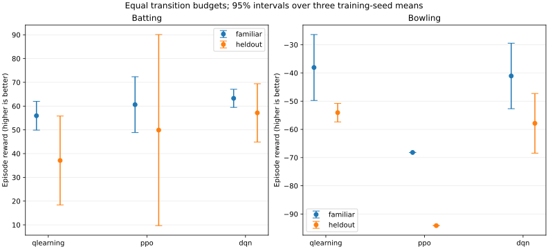
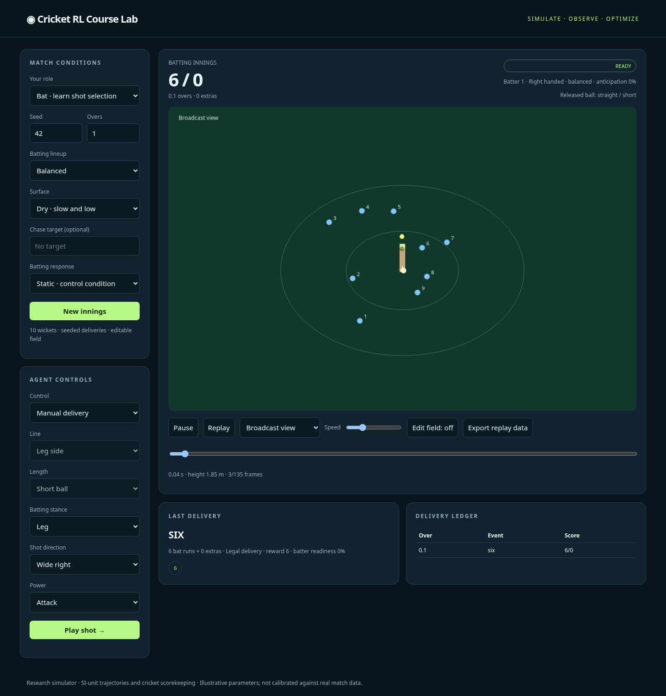
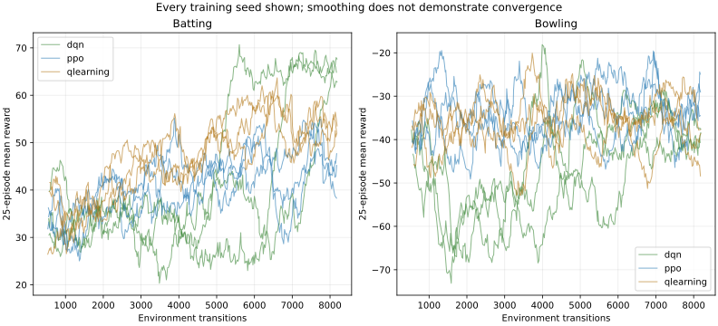

# Two-role course experiment

Budget: 18 runs × 8192 requested transitions. 50 evaluation innings per scenario; seeds [0, 1, 2]. Test seeds begin at 300000. All seeds retained. This is a short pipeline pilot, not evidence of convergence.

| Role | Algorithm | Scenario | Mean reward ± seed interval | Runs/innings | Wickets/innings |
|---|---|---|---:|---:|---:|
| batting | qlearning | familiar | 55.94 ± 6.04 | 68.85 | 1.61 |
| batting | qlearning | heldout | 37.10 ± 18.71 | 58.17 | 2.63 |
| batting | ppo | familiar | 60.61 ± 11.75 | 71.11 | 1.31 |
| batting | ppo | heldout | 49.90 ± 40.22 | 69.53 | 2.45 |
| batting | dqn | familiar | 63.27 ± 3.82 | 73.67 | 1.30 |
| batting | dqn | heldout | 57.15 ± 12.27 | 76.08 | 2.37 |
| bowling | qlearning | familiar | -38.06 ± 11.69 | 51.87 | 1.73 |
| bowling | qlearning | heldout | -54.06 ± 3.29 | 66.59 | 1.57 |
| bowling | ppo | familiar | -68.18 ± 0.00 | 82.26 | 1.76 |
| bowling | ppo | heldout | -94.12 ± 0.00 | 104.20 | 1.26 |
| bowling | dqn | familiar | -41.05 ± 11.61 | 50.01 | 1.12 |
| bowling | dqn | heldout | -57.85 ± 10.58 | 62.92 | 0.63 |

Baselines (episode means; no training-seed interval):

| Role | Baseline | Familiar reward | Held-out reward |
|---|---|---:|---:|
| batting | random | 31.00 | 26.34 |
| batting | reactive | 42.46 | 38.78 |
| bowling | random | -39.52 | -59.80 |
| bowling | varying | -32.18 | -38.36 |

Reward is runs − 8 × wickets for batting, and its negative for bowling. Roles have different opponents and decision timing; their scores are not a ranking between roles. Held-out combines expert attributes, dry pitch, and (for batting) varying bowling. This is a bundled stress test, not an isolated causal ablation.

Intervals are Student-t intervals across training-seed means, not a formal superiority test. The simulator remains uncalibrated. Frozen PPO seed-0 opponents were also exercised in both directions; see study.json. These matches are sequential fixed-policy evaluations, not simultaneous self-play or a win-rate league.

Actual completed budget: **147,456 transitions**, with **0 truncated learned-policy evaluation innings**.

The batting algorithms exceeded the reactive baseline in mean familiar-condition reward in this pilot. Held-out estimates are uncertain. Bowling learners did not beat the varying heuristic on average. This is a useful learning result: a neural algorithm is not automatically better than a small table or a hand-written rule.

The frozen batting/bowling model pair produced identical game scores and opposite rewards through the two role interfaces for all 50 matched seeds. This checks the shared simulator integration; it is not a claim of competitive performance.

See [the hands-on lessons](START_HERE.md), [API reference](API.md), and [machine-readable summary](summary.json). Full episode data, checkpoints and training curves remain in `runs/course-study/`.

