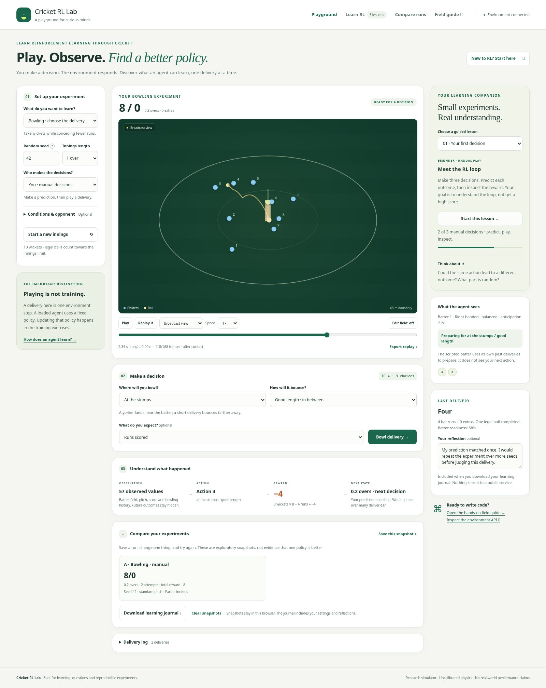

# Using and sharing the learning playground

Start the development server with `python -m cricket_rl.server`. The browser UI
and its field guide are served by that server, with local CSS, JavaScript and
system fonts. No CDN or analytics service is used. The main view is `/`; the
field guide is `/learn`. This remains a local development application, not a
hosted multi-user learning service.

## A learner's first five minutes

1. Choose **Your first decision** in the learning companion and start the lesson.
   This creates a fresh one-over innings with seed 42.
2. Choose a delivery and predict an outcome. Play it and inspect the transition:
   **observation → action → reward → next state**.
3. Repeat three times. Write a reflection rather than judging a strategy from one
   lucky outcome. Completion records participation, not mastery or policy quality.
4. Try **Repetition & adaptation** or **Find the field gap**. Each lesson starts a
   fresh innings. Previous delivery notes remain in the current page's journal
   archive until exported or the page is closed.
5. Download the learning journal to keep your settings, actions, predictions,
   outcomes and reflections. Then open the field guide to move into Python and
   tabular Q-learning.

## What the controls actually do

- **Who makes the decisions?** selects manual actions, random actions, a fixed
  heuristic, or a loaded model. None of these modes updates policy weights in the
  browser. Use the Python training exercises to train an agent.
- **Set up your experiment** contains the role, seed, innings length and optional
  conditions. Changed conditions must be applied with **Start a new innings**.
  Action choices and controller choices can change between deliveries.
- **Make a decision** shows only the controls for the current role. A policy-driven
  run disables manual action selectors; the actual action is shown afterward.
- **Reward** shows the actual role-specific calculation, including extras and
  wickets. Bowling and batting receive opposite rewards for the same delivery.
- **Replay** controls visual playback of an already completed transition. Scrubbing
  and changing cameras do not change the outcome. Reduced-motion preferences
  disable automatic playback; you can explicitly play it.
- **Edit field** supports dragging, numbered fielder selection, arrow buttons and
  arrow keys with the canvas focused. Positions stay inside the boundary and
  apply to the next delivery. A failed save restores server positions.

## Comparing and sharing experiments

Save up to four snapshots, then change one condition and run another experiment.
Snapshots record the controllers actually used, score, exposure and applied
settings. Partial innings are explicitly labeled. They are exploratory notes,
not statistical evidence that a policy is better. Different actions consume
random numbers differently even with the same starting seed.

Snapshots and lesson-completion flags are stored in this browser when storage is
available. Storage-disabled browsers retain the current page's snapshots in
memory. Reflections and delivery journals are not automatically persisted across
refreshes: download your journal to keep them. No public sharing or automatic
upload occurs. The browser demo includes declared frozen Q-learning checkpoints;
selecting one performs inference, not training. Their model card is linked from
the demo. Runtime recovery preserves earlier journal notes and makes them
exportable even before you play another delivery. Inspect a journal before circulating it if your reflections contain
private information.

A community contribution should include a hypothesis, settings, algorithm,
transition budget, training and evaluation seeds, baselines, all training runs,
results and limitations. Use the Python study tools for repeatable evaluation;
a screenshot cannot replace those measurements.

## Accessibility and failure states

The UI includes keyboard focus styles, a skip link, native labeled controls,
keyboard field movement, text explanations of colors and outcomes, reduced-motion
support, and layouts checked at 360, 768 and 1440 pixels. Screen-reader status
updates are limited to discrete outcomes; animation telemetry is not announced
on every frame. Browser tests exercise learning flows and keyboard field buttons.
This is not a claim of a formal WCAG audit.

If the backend is unavailable, actions remain disabled and a reconnect action is
shown. Invalid seed and target values leave the current innings intact. A trained
policy is selectable only when a checkpoint for the active role was loaded when
starting the server.

The application still needs production hosting, per-user sessions for the
playground, authentication if required, and deployment review before it is offered
as a public service. The isolated Gym API sessions are separate from the shared
local playground match.
