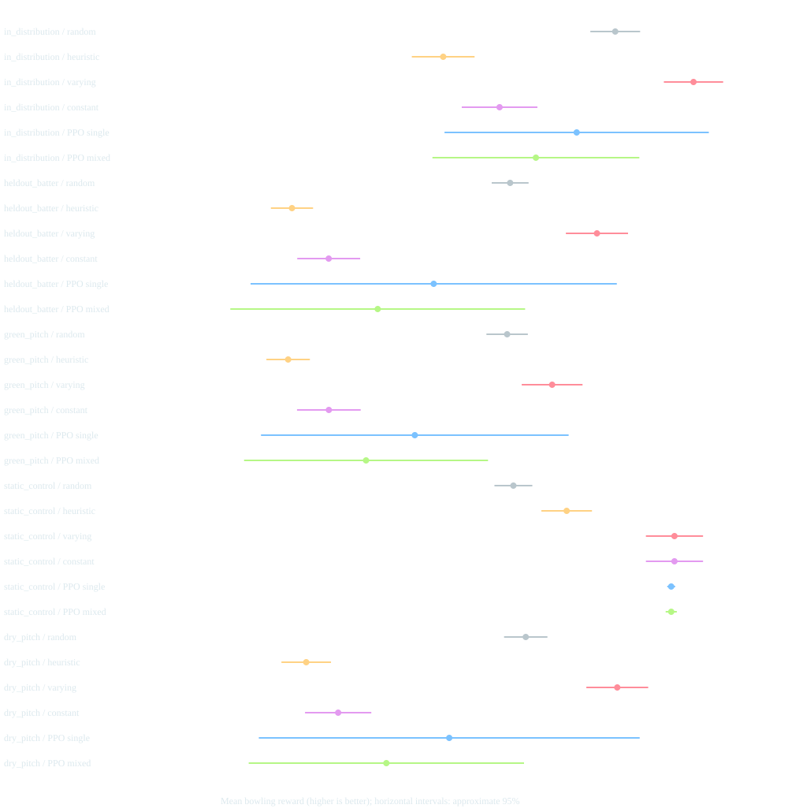
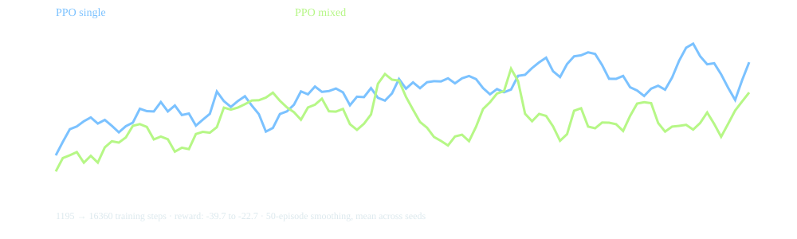

# Adaptive batting: measured results

## What changed

Batters now predict line/length patterns from their own decayed bowling memory. Preparation changes positioning, contact, timing, and shot placement; unexpected deliveries can defeat that preparation. The bowling reward remains unchanged. Observation version 3 exposes the history and adaptation flag in a 57-value vector. Previous 37-value checkpoints cannot be reused.

## Completed study

**10 new PPO runs × 16,384 steps = 163,840 training steps**, using five single-style and five mixed-style seeds. Each policy faced 100 innings in five scenarios: familiar lineups, held-out expert batters, green pitch, dry pitch, and a static-batting control. Four baselines add 2,000 evaluation innings to 5,000 PPO innings; 900 separate validation innings selected the constant delivery. This is the same per-model training budget as the original static study.

Truncated evaluation innings: **0**. No evaluation results were used to choose models or change the adaptation coefficients. The held-out data reported below are fixed pilot comparisons, not a convergence or SOTA claim.

## Does repetition still work?

| Baseline | Static batter reward ↑ | Adaptive batter reward ↑ | Static runs/over | Adaptive runs/over |
| --- | ---: | ---: | ---: | ---: |
| random | -59.31 | -59.98 | 18.57 | 18.32 |
| heuristic | -48.32 | -104.99 | 17.54 | 28.45 |
| varying | -26.08 | -42.07 | 18.83 | 20.88 |
| constant | -26.08 | -97.41 | 18.83 | 28.38 |

These baseline comparisons hold the policy and initial-state seeds fixed while switching batting adaptation. Action-dependent random draws diverge, so this is not identical delivery noise. The varying baseline switches between straight yorkers and good-length balls when the batter expects one of them. The constant baseline was selected only on familiar-batter validation seeds 50000–50099.

## Retrained policies on held-out expert batters

| Policy | Reward ↑ | Runs/over ↓ | Wickets/innings ↑ | Dominant action share |
| --- | ---: | ---: | ---: | ---: |
| random | -59.98 | 18.32 | 1.41 | 12.6% |
| heuristic | -104.99 | 28.45 | 0.83 | 49.0% |
| varying | -42.07 | 20.88 | 2.49 | 55.5% |
| constant | -97.41 | 28.38 | 1.15 | 100.0% |
| PPO single | -75.75 | 25.44 | 1.68 | 82.1% |
| PPO mixed | -87.30 | 27.01 | 1.43 | 92.1% |

PPO averages include all five seeds in each condition, including collapsed policies. Diverse actions alone do not establish use of memory, so the separate controlled diagnostic below tests sensitivity to history.

## Does the policy use bowling history?

Thirty synthetic matched-state probes hold score, batter, pitch and field positions fixed. Only the current batter’s history changes between six yorkers and six good-length balls. These interventions test input sensitivity, not playing performance; they do not choose a checkpoint.

**3 of 10 trained models** changed their action in at least one matched-history probe.

| Model | History changes action | Switches to opposite straight length |
| --- | ---: | ---: |
| fixed:3 | 0% | 0% |
| mixed-0 | 0% | 0% |
| mixed-1 | 0% | 0% |
| mixed-2 | 0% | 0% |
| mixed-3 | 0% | 0% |
| mixed-4 | 100% | 100% |
| single-0 | 0% | 0% |
| single-1 | 100% | 100% |
| single-2 | 100% | 100% |
| single-3 | 0% | 0% |
| single-4 | 0% | 0% |
| varying | 100% | 100% |

## Interpretation and limits

Repetition is now exploitable by the batter, and history-dependent bowling has a concrete mechanism to exploit. The probe results and per-seed outcomes must be read together: some agents may learn to respond while others collapse. The hand-written varying baseline is a serious comparator; adapting does not by itself imply PPO superiority.

Large scoring rates expose remaining calibration limits. These are invented opponent-response coefficients, not empirical estimates of real batter learning. The static-control scenario is outside the adaptive agents’ training distribution; its PPO results are not a pure causal ablation of training. Baseline static/adaptive comparisons isolate the simulator switch more directly.





PPO error bars are Student-t intervals over training-seed mean rewards. Baseline error bars are normal approximate episode-mean intervals. They capture different uncertainty sources and are not a formal pairwise significance test. Training curves use 50-episode smoothing and do not establish convergence.

## Artifacts and reproduction

- [Standalone results report](adaptive-report.html)
- [Machine-readable summary, source hashes and training metadata](adaptive-summary.json)
- [Offline adaptive-batting replay](adaptive-replay.html)
- `runs/adaptive-study/study.json`: episode-level outcomes for all policies and scenarios.
- `runs/adaptive-study/history-probes.json`: controlled history-sensitivity diagnostics.
- `runs/adaptive-study/{single,mixed}-{0..4}/`: new checkpoints and training monitor CSVs.
- [Original static-batting study](RESULTS.md) is preserved separately.

```bash
python -m cricket_rl.benchmark --steps 16384 --episodes 100 --workers 2 --output runs/adaptive-study
python -m cricket_rl.diagnostics runs/adaptive-study
python -m cricket_rl.server --model runs/adaptive-study/mixed-0/ppo.zip
```

The dashboard exposes adaptive/static batting, expected line/length, anticipation, and delivery readiness. A designated seed 0 is used in the example above rather than selecting the best-performing test checkpoint.
