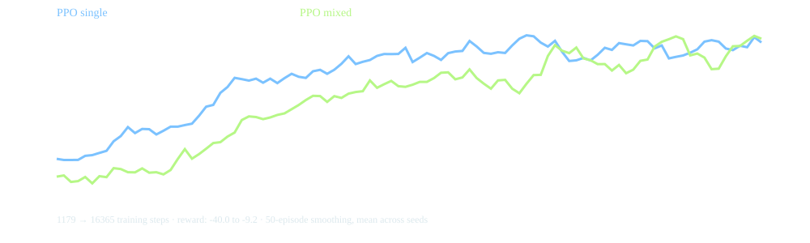

# Original static-batting pilot results

This archived experiment used observation version 2 (37 values), before adaptive
batting. Its checkpoints are incompatible with the current environment. See
[the adaptive-batting study](ADAPTIVE_RESULTS.md) for current results.

This study completed **10 PPO runs × 16,384 steps = 163,840 training steps**: five seeds for single-style training and five for mixed-style training. Each policy was evaluated over 100 innings in each of four scenarios. Three baselines add 1,200 evaluation innings to the 4,000 PPO evaluation innings; a separate 900-innings validation sweep selected the constant action. **No evaluation innings were truncated.**

All agents trained on the standard surface with the same PPO configuration. The held-out batter uses aggression 0.70 and skill 0.85. Evaluation seeds are 100000–100099; constant-baseline selection uses 50000–50099. This is a pilot budget, not demonstrated convergence.

## Findings

- PPO improved the chosen wicket-weighted reward over the random and field-aware heuristic baselines, mainly by taking wickets earlier. It did not improve economy rate against the heuristic.
- All five single-style agents selected action 3 (straight yorker) throughout the evaluated trajectories. Consequently, their between-training-seed reward intervals are zero even though finite-sample evaluation uncertainty remains.
- The constant-strategy baseline selected action 4 (straight good length) on the separate validation set. Its results are close to PPO. These runs do not establish a clear adaptive advantage over a simple constant bowling policy.
- Mixed-style training did not improve transfer in this experiment. This is a negative result for the motivating hypothesis at this budget and with these simulator assumptions.
- These outcomes expose a research limitation: the environment currently rewards straight deliveries strongly enough that contextual adaptation is not needed. More training alone is not evidence that this limitation is fixed.

## Held-out batter, standard pitch

| Policy | Reward ↑ | Runs per over ↓ | Wickets per innings ↑ | Dominant action share |
| --- | ---: | ---: | ---: | ---: |
| random | -59.31 | 18.57 | 1.50 | 12.6% |
| heuristic | -48.32 | 17.54 | 1.67 | 54.8% |
| constant | -27.57 | 18.91 | 2.71 | 100.0% |
| PPO single | -26.08 | 18.83 | 2.72 | 100.0% |
| PPO mixed | -26.97 | 18.88 | 2.71 | 100.0% |

## All scenarios and uncertainty

PPO intervals use Student-t uncertainty over five training-seed mean rewards. Baseline intervals use normal approximate uncertainty over evaluation episodes. These are different uncertainty sources; overlapping or non-overlapping intervals here are not a formal pairwise significance test. Evaluation episodes are shared across training seeds, so they are not 500 independent test conditions.

Training curves show 50-episode-smoothed mean reward across seeds. They are descriptive and do not establish convergence.

## Artifacts and reproduction

- [Standalone report](experiment-report.html): all metrics, uncertainty and action concentration.
- [Machine-readable summary](experiment-summary.json): actual budgets, versions, source hashes and per-condition results.
- `runs/study/study.json`: full episode-level data in this workspace (generated and Git-ignored).
- `runs/study/{single,mixed}-{0..4}/`: model checkpoints, training metadata, monitor CSVs and evaluation data.
- [README commands](../../README.md#train-and-evaluate) reproduce the complete study. `--reuse` re-evaluates retained checkpoints only after checking the training configuration and core simulator source hashes.

## Résumé wording supported by this work

> Built a trajectory-based cricket simulator and interactive replay dashboard with a Gymnasium RL interface; conducted a reproducible 10-run PPO study across four evaluation scenarios, identifying policy collapse and reward/economy trade-offs using constant-strategy baselines.

Do not claim state-of-the-art cricket performance, real-world predictive validity, or improved economy rate from these results. See [the technical report](REPORT.md) for model assumptions and scientific extensions.
